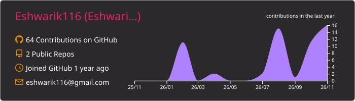
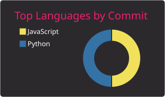

<div align="center">


[](https://github.com/Eshwarik116)

<br>

<a href="YOUR-LINKEDIN-URL"></a>
<a href="YOUR-LEETCODE-URL"></a>
<a href="mailto:eshwarikognole.pict@gmail.com"></a>

</div>

---

## 👩‍💻 About Me

```js
const eshwari = {
  role: "Backend & Full-Stack Developer",
  college: "Pune Institute of Computer Technology (PICT)",
  branch: "Electronics & Telecommunication Engineering",
  location: "Pune, India",
  building: ["REST APIs", "JWT Auth Systems", "MERN Apps"],
  currentlyLearning: ["AI", "Machine Learning", "RAG"],
  leetcode: "200+ problems solved",
  funFact: "I design PCBs and write backend APIs",
  openTo: "Internships & collaborations"
};
```

- 🔬 Co-authored a research preprint on real-time pothole detection using sensor fusion and dual ESP32, published on [Zenodo](https://doi.org/10.5281/zenodo.20760578)
- 🔐 Explored Android app security analysis with Docker and MobSF
- 🎯 Open to internships and collaborations in backend and full-stack development

## 🛠️ Tech Stack

<div align="center">

**Languages**


**Frontend**


**Backend & Databases**


**Tools**


**Currently Exploring**


**Core CS:** Data Structures & Algorithms · OOP · DBMS · Operating Systems · Computer Networks

</div>

## 🏆 Highlights

- 📄 Co-authored research preprint: [Real-Time Pothole Detection Based on Vision-Dominant Sensor Fusion and Dual ESP32 Architecture](https://doi.org/10.5281/zenodo.20760578)
- 🧩 200+ LeetCode problems solved, 100 Days Badge earned
- 📜 Oracle Cloud Infrastructure 2025 AI Foundations Associate
- 📜 Machine Learning Specialization, Stanford University (Andrew Ng), DeepLearning.AI

## 📊 GitHub Stats

<div align="center">





</div>

## 🐍 Contribution Snake

<div align="center">

<picture>
  <source media="(prefers-color-scheme: dark)" srcset="https://raw.githubusercontent.com/Eshwarik116/Eshwarik116/output/github-snake-dark.svg">
  
</picture>

</div>

<div align="center">


</div>